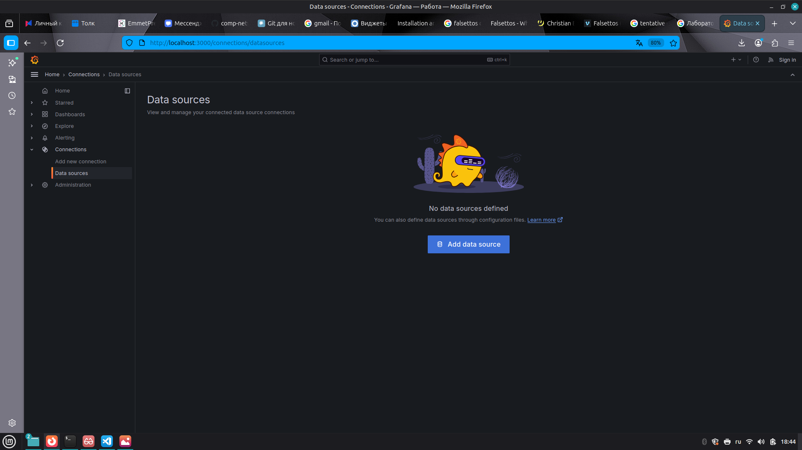
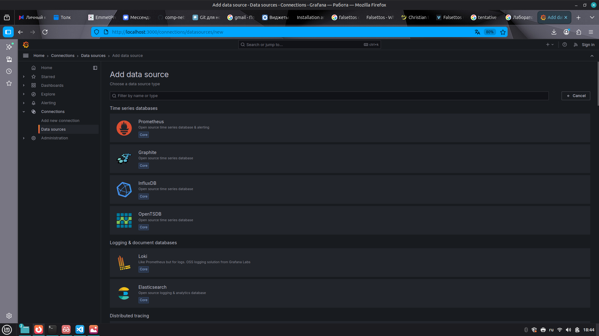
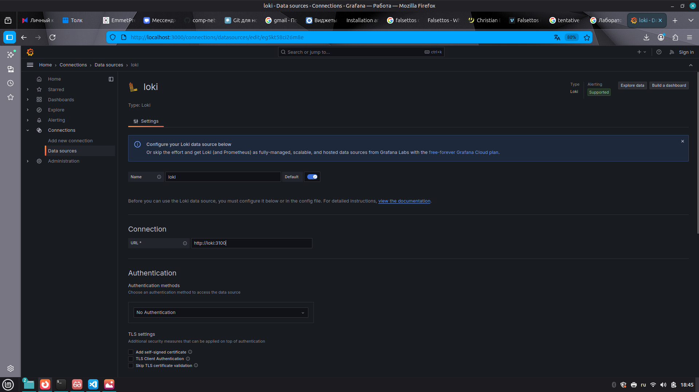
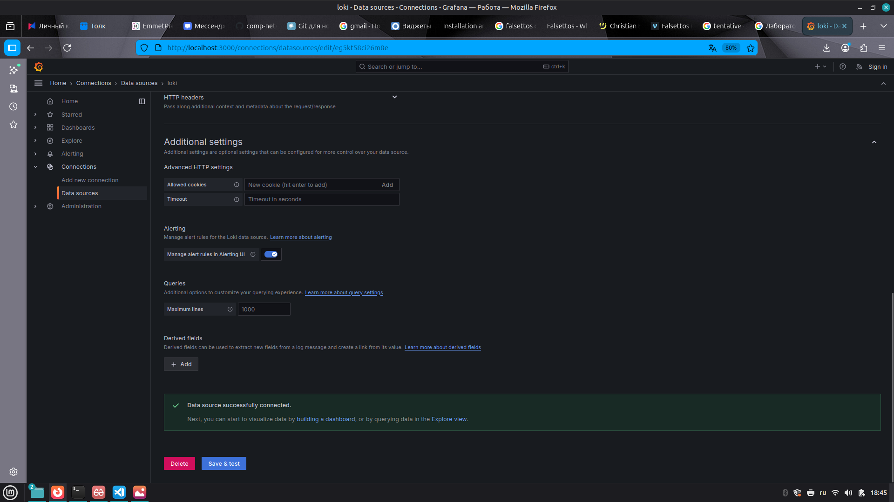
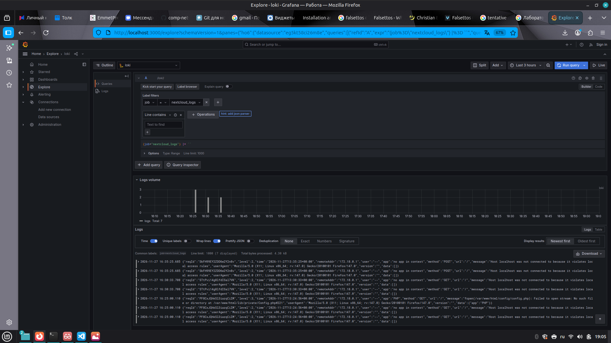
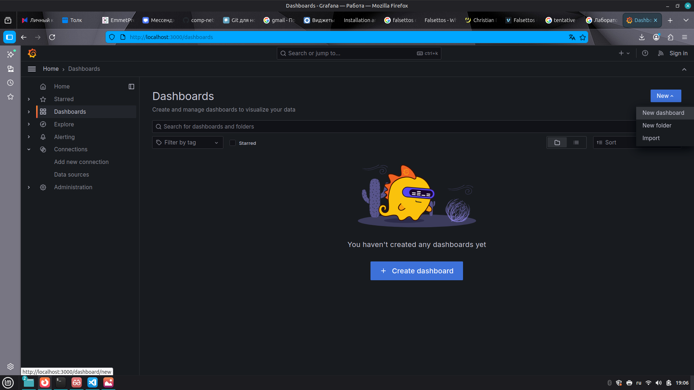
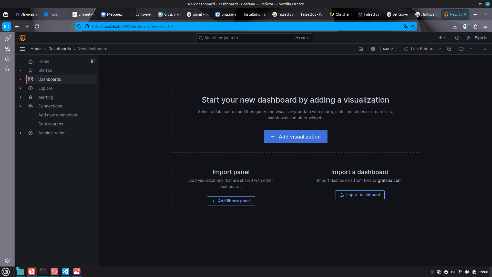
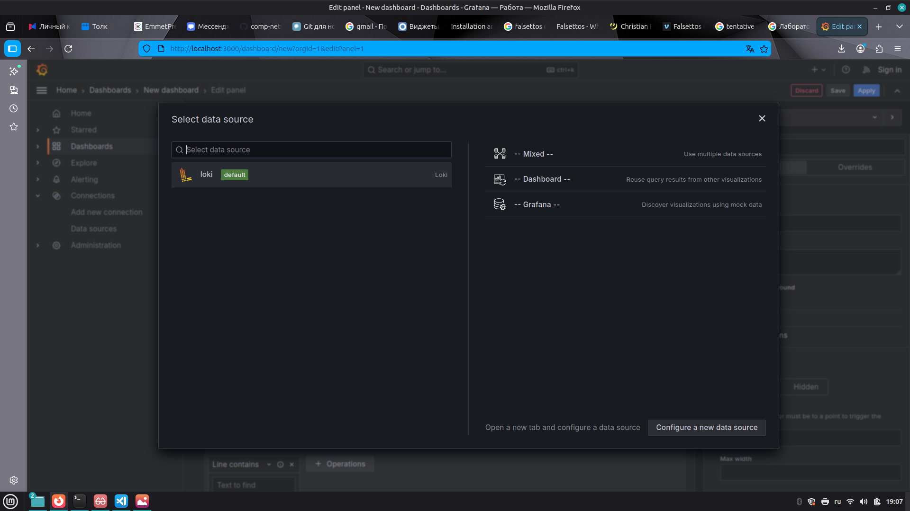
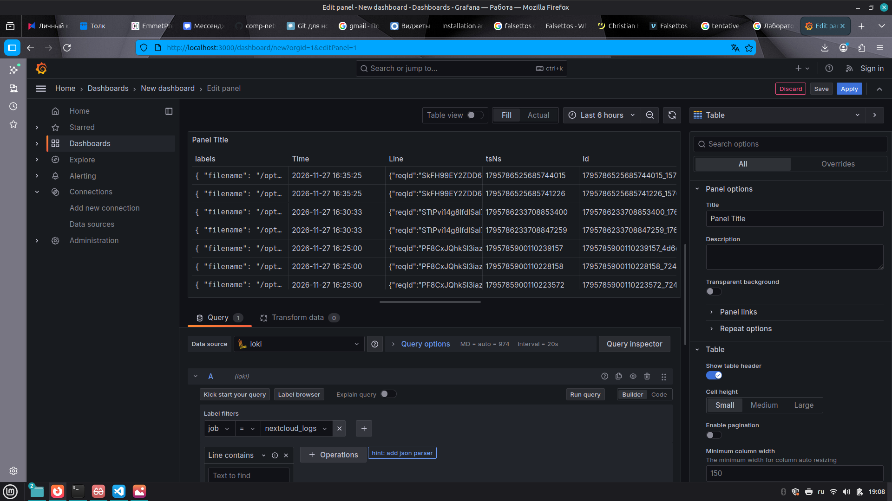
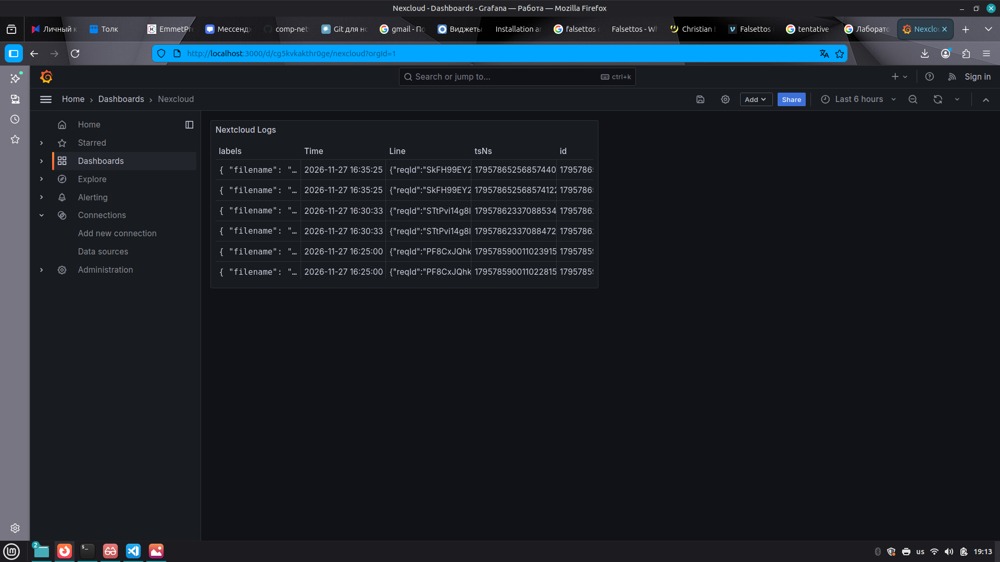

# Лабораторная работа № 1. Loki + Zabbix + Grafana

---

## Ход работы

### Часть 1. Настройка логирования (Nextcloud + Promtail + Loki)
#### 1. Подготовка конфигурационных файлов 

`docker-compose.yml`:

```yaml
services:

  nextcloud:
    image: nextcloud:29.0.6
    container_name: nextcloud # на это имя будет завязана настройка забикса далее, так что лучше не менять
    ports:
      - "8080:80"
    volumes:
      - nc-data:/var/www/html/data

  loki: # сервис-обработчик логов
    image: grafana/loki:2.9.0
    container_name: loki
    ports:
      - "3100:3100"
    command: -config.file=/etc/loki/local-config.yaml # запуск с дефолтным конфигом

  promtail: # сервис-сборщик логов
    image: grafana/promtail:2.9.0
    container_name: promtail
    volumes:
      - nc-data:/opt/nc_data # та же самая директория, которая монтируется в Nextcloud
      - ./promtail_config.yml:/etc/promtail/config.yml
    command: -config.file=/etc/promtail/config.yml

  grafana: # сервис визуализации
    environment:
      - GF_PATHS_PROVISIONING=/etc/grafana/provisioning # просто
      - GF_AUTH_ANONYMOUS_ENABLED=true # дефолтные
      - GF_AUTH_ANONYMOUS_ORG_ROLE=Admin # настройки
    command: /run.sh
    image: grafana/grafana:11.2.0
    container_name: grafana
    ports:
      - "3000:3000"

  postgres-zabbix:
    image: postgres:15
    container_name: postgres-zabbix
    environment:
      POSTGRES_USER: zabbix
      POSTGRES_PASSWORD: zabbix
      POSTGRES_DB: zabbix
    volumes:
      - zabbix-db:/var/lib/postgresql/data
    healthcheck:
      test: ["CMD", "pg_isready", "-U", "zabbix"]
      interval: 10s
      retries: 5
      start_period: 5s

  zabbix-server:
    image: zabbix/zabbix-server-pgsql:ubuntu-6.4-latest # непосредственно бэкенд забикса
    container_name: zabbix-back
    ports:
      - "10051:10051"
    depends_on:
      - postgres-zabbix
    environment:
      POSTGRES_USER: zabbix
      POSTGRES_PASSWORD: zabbix
      POSTGRES_DB: zabbix
      DB_SERVER_HOST: postgres-zabbix

  zabbix-web-nginx-pgsql:
    image: zabbix/zabbix-web-nginx-pgsql:ubuntu-6.4-latest # фронтенд забикса
    container_name: zabbix-front
    ports:
      - "8082:8080" # внешний порт можно любой по своему желанию
    depends_on:
      - postgres-zabbix
    environment:
      POSTGRES_USER: zabbix
      POSTGRES_PASSWORD: zabbix
      POSTGRES_DB: zabbix
      DB_SERVER_HOST: postgres-zabbix
      ZBX_SERVER_HOST: zabbix-back

volumes:
  nc-data:
  zabbix-db:
```

`promtail_config.yml`:

```yaml
server:
  http_listen_port: 9080
  grpc_listen_port: 0

positions:
  filename: /tmp/positions.yaml

clients:
  - url: http://loki:3100/loki/api/v1/push

scrape_configs:
  - job_name: system
    static_configs:
      - targets:
          - localhost
        labels:
          job: nextcloud_logs
          __path__: /opt/nc_data/*.log
```

#### 2. Запуск контейнеров и проверка статуса сервисов

Все контейнеры запущены


#### 3. Инициализация Nextcloud и проверка генерации логов

Откроем http://localhost:8080 и инициализируем Nextcloud


Проверим, что логи сохраняются в файл `nextcloud.log`


#### 4. Проверка захвата лог-файла агентом Promtail

Смотрим логи контейнера promtail


### Часть 2. Настройка мониторинга (Zabbix)
#### 1. Импорт шаблона мониторинга (`template.yml`)
#### 2. Настройка доверенных доменов (`trusted_domains`) в Nextcloud
#### 3. Создание и настройка хоста в Zabbix
#### 4. Проверка сбора метрик (*Latest data*) и тестирование срабатывания триггера (*Maintenance mode*)

### Часть 3. Интеграция и визуализация (Grafana)
#### 1. Установка и активация плагина Zabbix в Grafana
#### 2. Подключение источника данных Loki






#### 3. Подключение источника данных Zabbix
#### 4. Проверка получения данных в разделе *Explore*

Проверяем Loki


Проверяем Zabbix

### Практическое задание
#### 1. Тестирование запросов к источникам данных
#### 2. Создание дашборда с таблицей логов из Loki







#### 3. Создание дашборда с визуализацией статуса из Zabbix

## Ответы на контрольные вопросы

### 1. Чем SLO отличается от SLA?

SLO (Service Level Objective) - это внутренняя техническая цель команды, к которой инженеры стремятся при поддержке сервиса. Например, команда решает для себя, что сервис должен быть доступен 99,9% времени в месяц, а 95% запросов должны обрабатываться быстрее 200 миллисекунд.

SLA (Service Level Agreement) - это официальное юридическое соглашение или договор между поставщиком услуги и клиентом, в котором прописаны обязательства и реальные последствия за их нарушение (штрафы, компенсации, возврат средств). Поэтому в жизни SLA всегда ставят чуть ниже, чем SLO (например, внутренний ориентир SLO 99,95%, а в договоре SLA прописано 99,9%). Так остается запас прочности, чтобы заметить деградацию и починить систему раньше, чем компания начнет платить штрафы клиентам.

### 2. Чем отличается инкрементальный бэкап от дифференциального?

Инкрементальный бэкап сохраняет только те файлы, которые изменились или появились с момента последнего любого бэкапа (полного или предыдущего инкрементального). За счет этого он создается максимально быстро и занимает меньше всего места на диске, но для восстановления данных придется по цепочке накатывать сначала полный бэкап, а затем по очереди каждый инкрементальный снимок.

Дифференциальный бэкап каждый раз сохраняет все изменения, накопившиеся с момента последнего полного бэкапа. Со временем такие копии начинают занимать больше места и создаваться дольше, чем инкрементальные, зато восстанавливать систему гораздо проще и надежнее: достаточно взять всего два файла - последний полный бэкап и самый свежий дифференциальный.

### 3. В чем разница между мониторингом и observability?

Мониторинг и observability (наблюдаемость) - это два уровня понимания того, что происходит с системой.

Мониторинг отвечает на вопрос «Работает ли сервис прямо сейчас?». Он следит за заранее известными показателями (например, Zabbix каждую минуту проверяет статус Nextcloud) и оповещает, если что-то выходит за рамки нормы. Однако когда тревога сработала, он говорит, что сломалось, но не объясняет почему. Здесь подключается observability: это свойство системы отдавать достаточно подробных данных - метрик, логов и трассировок, - чтобы инженер мог понять первопричину любой, даже неизвестной ранее ошибки. В нашей работе за это отвечает связка Promtail + Loki + Grafana: когда статус становится красным, мы открываем сырые логи Nextcloud и видим точный контекст ошибки.
